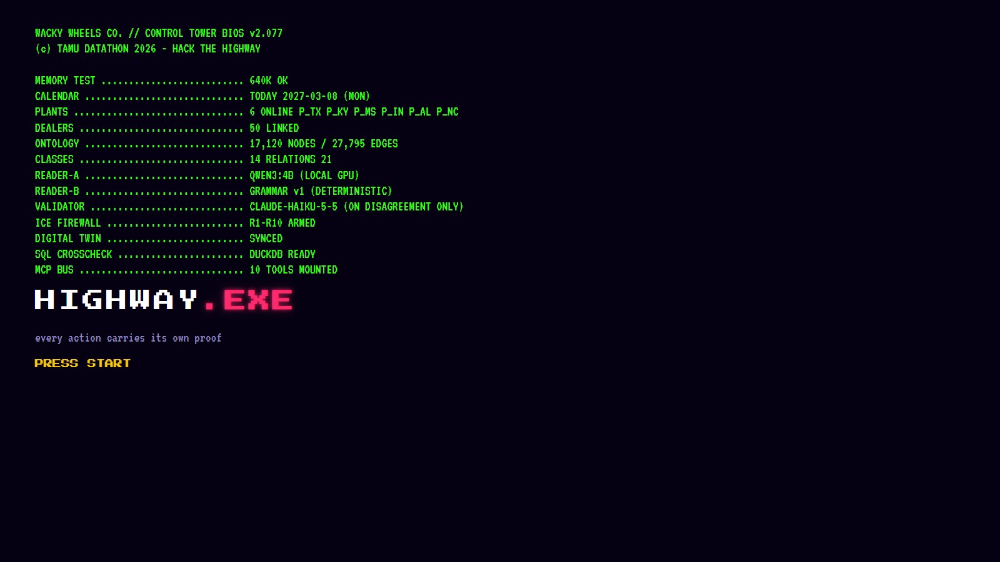
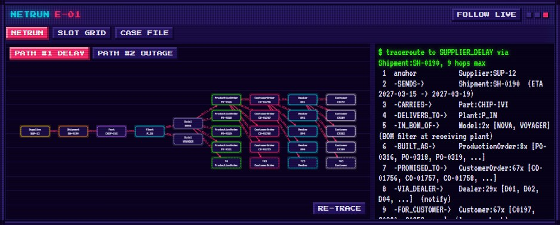
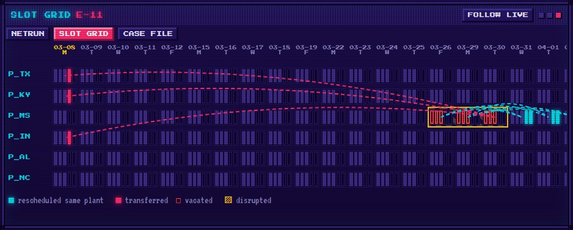
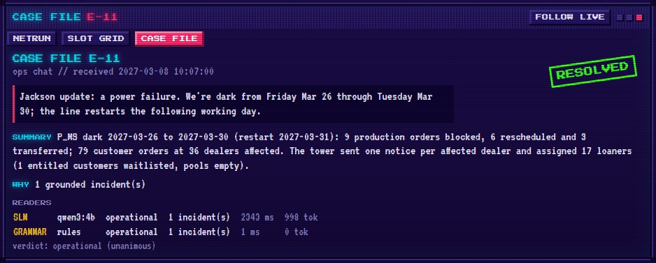
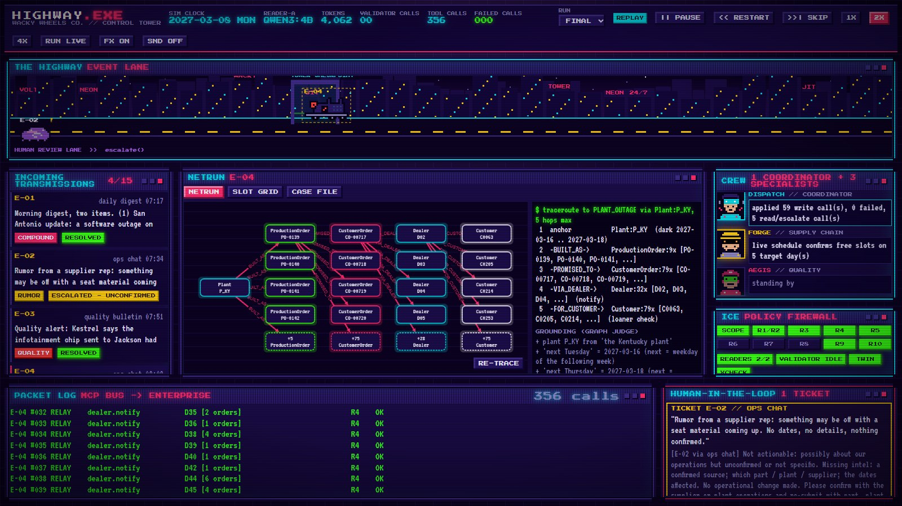

<p align="center"></p>

# HIGHWAY.EXE

**A multi-agent control tower for Wacky Wheels Co. where every action carries its own proof.**

- 🥈 **2nd place, Hitachi Solutions "Hack the Highway" track, TAMU Datathon 2026**
- Live Deployment: [highway-exe.netlify.app](https://highway-exe.netlify.app/) (replay of the final run; LIVE mode runs locally)
- Devpost: [devpost.com/software/highway-exe](https://devpost.com/software/highway-exe)
- Demo video: [youtube.com/watch?v=WqwzleDfF5E](https://www.youtube.com/watch?v=WqwzleDfF5E)
- Design card: [docs/design_card.md](docs/design_card.md)

<a href="https://youtu.be/WqwzleDfF5E"></a>

A local small model reads each operations message. Deterministic code grounds it in a 17k-node knowledge graph, plans the corrective actions by the policy handbook, and proves each tool call three ways before it touches the enterprise server. The control tower UI is a pixel-cyberpunk retro OS where every event drives in as a vehicle.

- **Final run:** 15/15 events pass the audit, 879 tool calls, 0 failed, 15 LLM calls, 61.6 s.
- **Models:** Qwen3 4B on Ollama reads; Claude Haiku 5.5 breaks reader ties.
- **Run it:** see [Quick Start](#quick-start).

## The Challenge

Built at **TAMU Datathon 2026** for the **Hitachi Solutions** track, *Hack the Highway*, where it won **2nd place**.

Wacky Wheels Co. is a just-in-time automaker with no parts inventory, so one late shipment, plant outage or bad part lot ripples into production schedules, dealers, loaner cars and owners. The track asks for one coordinating agent and three specialists that read a feed of 15 operations messages, trace each one through a knowledge graph of the company, and fix it with the enterprise tools while following the policy handbook. The messages mix supplier delays, plant outages, quality holds, noise, unconfirmed rumors and multi-incident digests, written the way people actually write. Noise must be ignored, rumors escalated to a human, and every event explained with a graph path and a reasoning trace. Everything runs on a laptop against a local enterprise server.

The organisers' brief and starter package are in [vendor/hack_the_highway_package/](vendor/hack_the_highway_package).

## Demo

| Boot sequence | NETRUN traceroute (E-01) |
|:-:|:-:|
|  |  |
| **SLOT GRID (E-11)** | **CASE FILE (E-11)** |
|  |  |



## How It Works

1. **Two readers.** `qwen3:4b` on the laptop GPU and a deterministic grammar reader each read the event. Names and date phrases are copied verbatim; the model never outputs ids, dates or actions.
2. **Graph judge.** Both readings are grounded in the knowledge graph. Only combinations the data supports survive. If the readers disagree, Claude Haiku casts a third vote; if nothing settles, the tower escalates with a missing-intel checklist.
3. **Agents.** DISPATCH coordinates. FORGE plans reschedules and transfers, AEGIS runs quality holds, RELAY sends dealer notices, loaners and owner contacts. Each agent can only call its own tools.
4. **Proof gates.** ICE checks handbook rules R1 to R10, TWIN dry-runs the plan on the organisers' own enterprise model, CROSSCHECK recomputes every affected set in DuckDB SQL. Only then does APPLY call the tools, through an MCP server.
5. **Explain.** Each event gets a trace (readings, graph path, traceroute, slot reasoning, loaner ranking, proofs, every call) and a case file.

Details: [docs/design_card.md](docs/design_card.md).

## Quick Start

Needs Python 3.11+, Node 20 and [Ollama](https://ollama.com). For the optional Haiku validator, put `ANTHROPIC_API_KEY` in `.env`.

```bash
pip install -r requirements.txt
ollama pull qwen3:4b
cd ui && npm install && npm run build && cd ..
```

Start the organisers' enterprise server in one terminal, then run the tower and open the UI at http://localhost:8765 from another:

```bash
python vendor/hack_the_highway_package/enterprise_server.py --data vendor/hack_the_highway_package/data --out runs/demo
python -m tower.run --out runs/demo
python -m tower.api
```

## Deploy

[highway-exe.netlify.app](https://highway-exe.netlify.app/) is a static replay of `runs/final`, built by [netlify.toml](netlify.toml). It is not linked to this repo, so redeploy by hand:

```bash
python -m tower.api.export_static && npx netlify-cli deploy --build --prod --dir ui/dist
```

`--dir` is needed because netlify-cli 27 resolves `publish` against the repo root instead of `ui/`.

## Submission Artifacts

| What | Where |
|---|---|
| Action log | [runs/final/action_log.jsonl](runs/final/action_log.jsonl) |
| Trace per event | [runs/final/traces/](runs/final/traces) |
| Case files (summary + reason per event) | [runs/final/case_files.md](runs/final/case_files.md) |
| Replay audit | [runs/final/audit.json](runs/final/audit.json) |
| Ontology and graph export | [docs/ontology/](docs/ontology) (Turtle, Mermaid, JSONL) |
| Design card | [docs/design_card.md](docs/design_card.md) |
| Reader benchmark | [docs/reader_benchmark.json](docs/reader_benchmark.json) |

## Layout

```
tower/kg        ontology, graph build, impact traversals, exports
tower/ground    calendar, date grammar, entity resolver, graph judge
tower/intake    SLM reader, grammar reader, Haiku validator, prompts
tower/agents    dispatch, forge, aegis, relay
tower/policy    rule registry, shared ledger
tower/verify    ICE firewall, digital twin, SQL crosscheck
tower/exec      MCP server over the enterprise API, executor
tower/trace     traces and case files
tower/api       backend for the UI
ui/             React + Vite control tower
eval/           replay auditor, synthetic events, reader benchmark
tests/          pytest suite
vendor/         organisers' starter package, unmodified
```
